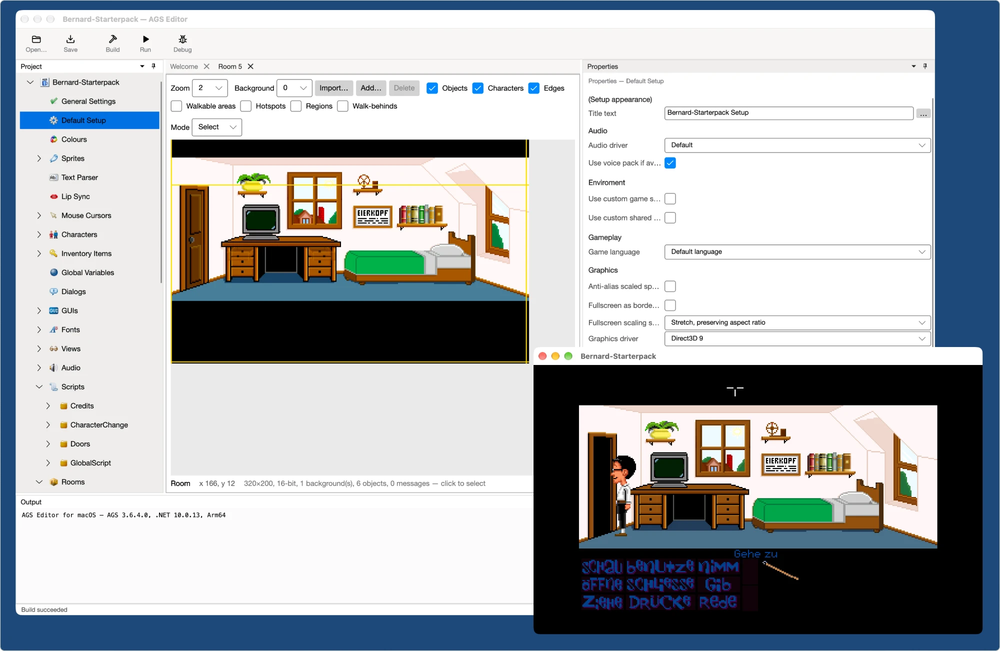

# AGS Editor for macOS (ags-for-mac)

**Deutsch** · [English](#english)



> **Experimentelles Projekt.** Ich experimentiere gerade damit, mithilfe von KI-Tooling den AGS-Editor auf
> .NET 10 / Avalonia UI für macOS (Apple Silicon) zu portieren, um der Mac-Community zu helfen.

## Worum es geht

Dies ist der Editor von [Adventure Game Studio (AGS)](https://www.adventuregamestudio.co.uk) als native
macOS-App für Apple Silicon. Er ist **kein Fork** und keine eigene AGS-Variante, sondern ein inoffizieller Zusatz.
Das Original – den offiziellen Editor für Windows, die Engine, Handbuch und Forum – findest du auf
[adventuregamestudio.co.uk](https://www.adventuregamestudio.co.uk) und
[github.com/adventuregamestudio/ags](https://github.com/adventuregamestudio/ags).

> **Bitte keine Fragen zu ags4mac im AGS-Forum oder im AGS-Issue-Tracker.** Das AGS-Team hat mit diesem Port nichts
> zu tun. Probleme und Feedback bitte direkt an mich (Issues in diesem Repository).

- **100 % kompatibel:** Er öffnet und speichert dieselben Projektdateien wie der Windows-Editor (`Game.agf`, Räume,
  Sprites, Skripte, Übersetzungen …). Ein Projekt kann zwischen Windows und Mac hin- und hergereicht werden.
- **Derselbe Code:** Die Datenstrukturen, der Skript-Compiler, die Build-Werkzeuge und die Engine werden direkt aus dem
  AGS-Quellcode gebaut – unverändert bis auf wenige Fehlerkorrekturen, die noch auf die Übernahme bei AGS warten. Nur
  die Windows-Oberfläche (WinForms) ist durch eine neue Oberfläche mit [Avalonia UI](https://avaloniaui.net) ersetzt.
  Wo möglich wird die Original-Logik 1:1 übernommen.
- **Fehlerkorrekturen gehen zurück an AGS:** Fehler im AGS-Code, die bei der Portierung aufgefallen sind, werden als
  kleine Patches gepflegt ([`native/patches`](native/patches/README.md)) und als Pull Requests beim AGS-Projekt
  eingereicht. Mehrere davon wurden bereits übernommen.

## Mit KI gebaut

Dieses Projekt entsteht mit [Claude Code](https://claude.com/claude-code). Die KI schreibt den Großteil des Codes;
ich teste, gebe die Richtung vor und prüfe die Ergebnisse. Mehr als 250 automatische Tests prüfen jede Änderung gegen
ein echtes AGS-Spiel, unter anderem, ob das Spiel danach mit den AGS-Werkzeugen noch baut und ob Räume für die
AGS-Werkzeuge unverändert bleiben. Auch das Mac-Aussehen der Oberfläche (Icons, Layout, Einstellungsfenster) ist mit
KI gestaltet; die klassische Ansicht in den Einstellungen bleibt näher am Windows-Editor.

Für Beiträge an AGS selbst gilt die [KI-Richtlinie des AGS-Projekts](https://github.com/adventuregamestudio/ags/pull/3025)
(„Use of AI Tooling“): Code darf mit KI-Hilfe entstehen, ich muss ihn aber verstehen und dafür geradestehen. Pull
Requests und Kommentare bei AGS schreibe ich selbst, und KI-generierte Grafiken, Texte oder Oberflächen gehen nicht an
AGS.

Trotzdem gilt: **Das ist ein Experiment.** Mach vor der Arbeit mit eigenen Projekten immer eine Sicherungskopie.

## Was mir wichtig ist

AGS ist ein großartiges Werkzeug, das seit über 25 Jahren von Chris Jones und einer engagierten Community entwickelt
wird. Dieses Projekt soll **eine Ergänzung** für alle sein, die auf dem Mac arbeiten. Es hat nicht den Anspruch, die
Arbeit des AGS-Teams zu ersetzen oder mit KI-generiertem Code zu konkurrieren. Wenn etwas davon für AGS selbst nützlich
ist, gebe ich es gern zurück.

## Testen und Feedback

Wer AGS auf dem Mac nutzt – gerade auch in der Maniac-Mansion-Mania-Community –, ist herzlich eingeladen, ags4mac mit
eigenen Projekten auszuprobieren. **Feedback ist sehr willkommen:** was fehlt, was anders ist als unter Windows, was
abstürzt. Bitte immer mit einer **Kopie** des Projekts arbeiten.

## Stand

Die meisten Funktionen des Windows-Editors sind vorhanden:

- Projektbaum mit Figuren, Inventar, Views, Dialogen, GUIs, Räumen, Skripten, Audio, Schriften, Übersetzungen
- Raum-Editor mit Objekten, Kanten und Masken
- GUI-, View- und Dialog-Editor
- Skript-Editor mit Syntax-Hervorhebung, Autovervollständigung, Calltips und Find All Usages
- Sprite-Verwaltung inklusive Import, Sprite-Sheets, Export und Zuschneiden
- Bauen, Starten und Debuggen (Breakpoints, Einzelschritte), Ausgabe als macOS-App
- Andockbare Fenster, Mac-Aussehen oder klassische Ansicht, hell und dunkel (Einstellungen mit ⌘,)

Das Debuggen nutzt eine Engine-Erweiterung, die bei AGS noch geprüft wird
([adventuregamestudio/ags#3162](https://github.com/adventuregamestudio/ags/pull/3162)). Offen sind unter anderem die
Signierung und Notarisierung der App; einzelne seltene Funktionen (z. B. sehr alte Spiele vor AGS 3.0) fehlen noch.

Wie der Port aufgebaut ist und welche Teile des AGS-Codes übernommen wurden: [`docs/FORKED_FILES.md`](docs/FORKED_FILES.md)
(englisch). Die Korrekturen am AGS-Code: [`native/patches`](native/patches/README.md).

## Selbst bauen

Voraussetzungen: macOS auf Apple Silicon, [.NET 10 SDK](https://dotnet.microsoft.com), Xcode Command Line Tools,
[Homebrew](https://brew.sh) mit `cmake` und `sdl2`.

```sh
# 1. Den AGS-Quellcode im getesteten Stand neben die Projektdateien holen (Ordner "ags")
git clone https://github.com/adventuregamestudio/ags.git ags
git -C ags checkout edf5bb991
#    und das Testspiel (Maniac Mansion Mania "Bernard Starterpack")
git clone https://github.com/ManiacMansionMania/Bernard-SP.git testdata/Bernard-SP

# 2. Native Teile bauen: libagsnative, AGS-Werkzeuge und Engine (mit den Patches aus native/patches)
scripts/build-native.sh
scripts/build-upstream-tools.sh

# 3. Tests ausführen und die App bauen (build/AGS Editor.app)
scripts/test-all.sh
scripts/make-app.sh
```

Getestet wird gegen den AGS-Stand `master` @ `edf5bb991` und das Testspiel @ `fa24c33`. Mit einem neueren AGS-Stand
kann der Build scheitern, wenn sich Dateien geändert haben, die `native/patches` korrigiert.

---

<a name="english"></a>
# English

> **Experimental project.** I'm currently experimenting with using AI tooling to port the AGS Editor to
> .NET 10 / Avalonia UI for macOS (Apple Silicon), to help the Mac community.

## What this is

This is the editor of [Adventure Game Studio (AGS)](https://www.adventuregamestudio.co.uk) as a native macOS app
for Apple Silicon. It is **not a fork** and not a separate flavour of AGS, but an unofficial addition. The original –
the official editor for Windows, the engine, the manual and the forums – is at
[adventuregamestudio.co.uk](https://www.adventuregamestudio.co.uk) and
[github.com/adventuregamestudio/ags](https://github.com/adventuregamestudio/ags).

> **Please don't ask about ags4mac in the AGS forums or the AGS issue tracker.** The AGS team has nothing to do with
> this port. Please send problems and feedback to me directly (issues in this repository).

- **100 % compatible:** it opens and saves the same project files as the Windows editor (`Game.agf`, rooms, sprites,
  scripts, translations …). A project can be passed back and forth between Windows and Mac.
- **The same code:** the data model, the script compiler, the build tools and the engine are built straight from the
  AGS sources – unmodified apart from a few fixes that are waiting to be merged by AGS. Only the Windows user interface
  (WinForms) is replaced by a new one built with [Avalonia UI](https://avaloniaui.net). Wherever possible the original
  logic is carried over as it is.
- **Fixes go back to AGS:** bugs in the AGS code found while porting are kept as small patches
  ([`native/patches`](native/patches/README.md)) and submitted as pull requests to the AGS project. Several of them
  have already been merged.

## Built with AI

This project is being made with [Claude Code](https://claude.com/claude-code). The AI writes most of the code; I test
it, set the direction and review the results. More than 250 automated tests check every change against a real AGS
game, including whether the game still builds with the AGS tools afterwards and whether rooms stay unchanged for the
AGS tools. The Mac look of the interface (icons, layout, settings window) is AI-designed as well; the classic look in
the settings stays closer to the Windows editor.

Contributions to AGS itself follow the [AGS project's AI policy](https://github.com/adventuregamestudio/ags/pull/3025)
("Use of AI Tooling"): code may be written with AI help, but I have to understand it and stand behind it. I write
pull requests and comments at AGS myself, and no AI-generated artwork, text or interface design goes to AGS.

Still: **this is an experiment.** Always back up your projects before working on them with it.

## What matters to me

AGS is a wonderful tool, developed for more than 25 years by Chris Jones and a dedicated community. This project is
meant as **an addition** for everyone working on a Mac. It does not aim to replace the work of the AGS team or to
compete with it through AI-generated code. If any of it is useful for AGS itself, I'm happy to give it back.

## Testing and feedback

If you use AGS on a Mac – especially in the Maniac Mansion Mania community – you're very welcome to try ags4mac with
your own projects. **Feedback is very welcome:** what's missing, what behaves differently from Windows, what crashes.
Always work on a **copy** of your project.

## Status

Most features of the Windows editor are there:

- Project tree with characters, inventory, views, dialogs, GUIs, rooms, scripts, audio, fonts and translations
- Room editor with objects, edges and masks
- GUI, view and dialog editors
- Script editor with syntax highlighting, autocomplete, calltips and Find All Usages
- Sprite manager with import, sprite sheets, export and cropping
- Build, run and debug (breakpoints, stepping), packaging as a macOS app
- Dockable panels, Mac look or classic look, light and dark (settings with ⌘,)

Debugging uses an engine extension that is still under review at AGS
([adventuregamestudio/ags#3162](https://github.com/adventuregamestudio/ags/pull/3162)). Still open are, among other
things, signing and notarizing the app; a few rare features (e.g. very old games from before AGS 3.0) are missing.

How the port is put together and which parts of the AGS code it carries over: [`docs/FORKED_FILES.md`](docs/FORKED_FILES.md).
The fixes to the AGS code: [`native/patches`](native/patches/README.md).

## Building it yourself

Requirements: macOS on Apple Silicon, the [.NET 10 SDK](https://dotnet.microsoft.com), the Xcode command line tools,
[Homebrew](https://brew.sh) with `cmake` and `sdl2`.

```sh
# 1. Get the AGS sources at the tested revision next to the project files (folder "ags")
git clone https://github.com/adventuregamestudio/ags.git ags
git -C ags checkout edf5bb991
#    and the test game (Maniac Mansion Mania "Bernard Starterpack")
git clone https://github.com/ManiacMansionMania/Bernard-SP.git testdata/Bernard-SP

# 2. Build the native parts: libagsnative, the AGS tools and the engine (with the patches from native/patches)
scripts/build-native.sh
scripts/build-upstream-tools.sh

# 3. Run the tests and build the app (build/AGS Editor.app)
scripts/test-all.sh
scripts/make-app.sh
```

Tested against AGS `master` @ `edf5bb991` and the test game @ `fa24c33`. With a newer AGS revision the build can fail
if files that `native/patches` corrects have changed.

---

Adventure Game Studio © Chris Jones and the AGS contributors — <https://github.com/adventuregamestudio/ags>
Test game: Maniac Mansion Mania "Bernard Starterpack" — <https://github.com/ManiacMansionMania/Bernard-SP>
